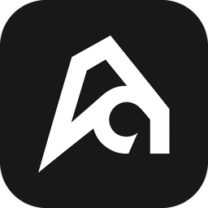
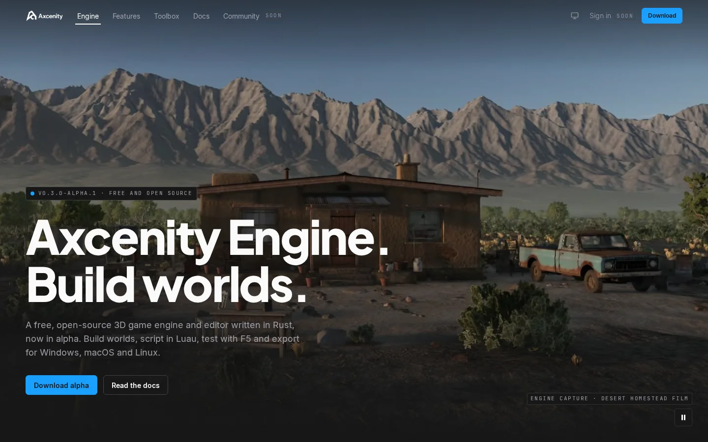
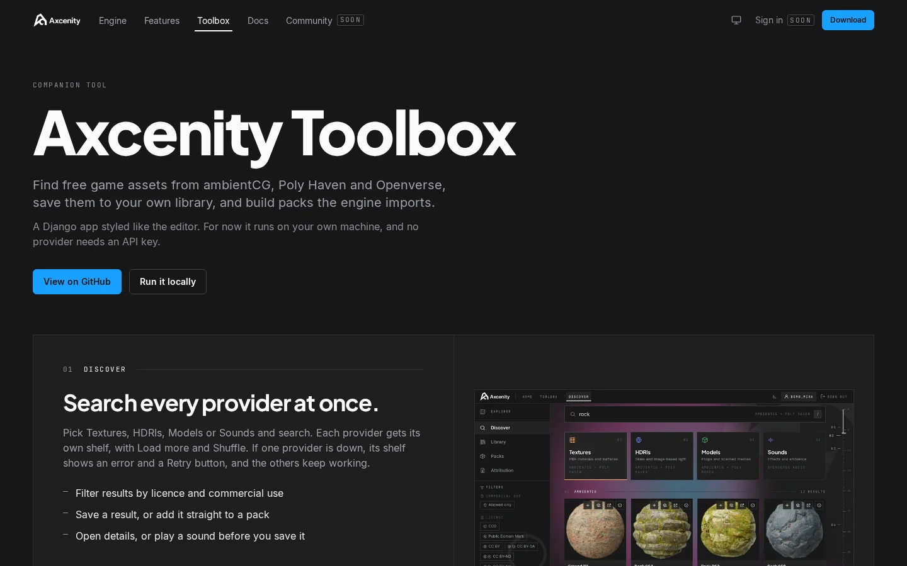

<p align="center">
  
</p>

<h1 align="center">Axcenity Hub</h1>

<p align="center">
  <strong>The web home for Axcenity™ Engine users, built with Django.</strong><br>
  <em>Internal development repository.</em>
</p>

<p align="center">
  <a href="plans/axcenity-hub.md">Build plan</a> ·
  <a href="prd/axcenity-hub.md">PRD</a> ·
  <a href="docs/ARCHITECTURE.md">Architecture</a> ·
  <a href="docs/FRONTEND.md">Frontend</a> ·
  <a href="docs/TESTING.md">Testing</a> ·
  <a href="https://github.com/Axcenity-Studios/Axcenity-Engine">Engine repo</a>
</p>

---

Axcenity Hub is the central website for the Axcenity Engine: public marketing pages first (Home, the Toolbox overview, Download and Docs), then accounts, projects and teams, forums, showcases, bug reports, moderation and a REST API. It's built in vertical slices, one plan phase at a time, as the CIDM final project.

> **Status:** Internal and in development. Phases 1–6B of [the plan](plans/axcenity-hub.md) are done (the public Home and Toolbox pages, and the documentation site at `/docs/`); Phase 6C, the API reference, is next. Nothing is deployed yet, and the settings are development defaults. The engine itself is alpha (`v0.3.0-alpha.1`), and the site's copy says so.

<p align="center">
  <br>
  <em>The Home page on the development server (1440 × 900, dark). The hero film behind it is an engine capture of the desert homestead scene.</em>
</p>

## Project status

Ticked boxes in [plans/axcenity-hub.md](plans/axcenity-hub.md) are the source of truth; this table is a summary.

| Phase | What it builds | State |
|---|---|---|
| **1** | Skeleton, theme (dark/light) and marketing shell | Done |
| **2** | Home content (rotating headline, pillars, workflow) | Done |
| **3–4** | The animated showcase reel and its scenes | Done (Phase 3's DPR and 60 fps check is still open) |
| **5** | Feature media: captures, derivatives and the media manifest | Done |
| **6** | `/toolbox/`: the Toolbox overview page | Done |
| **6B** | `/docs/`: the engine documentation site, from a committed snapshot | Done |
| **6C** | The API reference's layout and docs search | Done |
| **7** | `/download/`: releases from the GitHub API | Done |
| **8–9** | Accounts, two-factor sign-in, GitHub linking | Next |
| **10–11** | Projects, repository integration and teams | Planned |
| **12–15** | Forums, showcases, bug reports, moderation | Planned |
| **16–17** | REST API, and porting the Toolbox into the Hub | Planned |

<p align="center">
  <br>
  <em>The Toolbox page (<code>/toolbox/</code>). The screenshot inside it is a real capture of the running Toolbox, not of the engine.</em>
</p>

## Technology stack

| Layer | Technology | Notes |
|---|---|---|
| **Language** | Python 3.13 | Pinned in [`.python-version`](.python-version) |
| **Package manager** | [uv](https://docs.astral.sh/uv/) | uv only: no pip, no Node, no npm. Lockfile: [`uv.lock`](uv.lock) |
| **Web framework** | Django 6.1 | Class-based views; every URL named and namespaced |
| **Styling** | Tailwind CSS 4 + DaisyUI via [django-tailwind-cli](https://github.com/django-commons/django-tailwind-cli) | Uses the standalone Tailwind binary (downloaded once into `.django_tailwind_cli/`), so there's no Node toolchain. Source: [`styles/source.css`](styles/source.css) |
| **Interactivity** | Vanilla JavaScript (ES modules), Canvas 2D | The reel and animated loops in [`static/reel/`](static/reel/); any library is a vendored file. HTMX joins with the members' pages |
| **Images** | Pillow | `make_media` cuts captures into AVIF, WebP and JPEG derivatives |
| **Docs** | markdown-it-py, Pygments, PyYAML | The engine docs rendered server-side (raw HTML off), Luau highlighted as the editor does; `sync_engine_docs` copies them in |
| **GitHub API** | requests, responses (tests) | `/download/` reads the engine's release list with ETags and an hourly cache; tests mock GitHub with `responses` |
| **Database** | SQLite (development and tests) | PostgreSQL planned for production |
| **Tests** | pytest, pytest-django, pytest-playwright (Chromium) | Fast suite plus browser tests behind a `browser` marker |
| **Lint and format** | Ruff | Rules: `E F W I B UP DJ`, line length 100 |
| **Planned** | django-allauth (auth, GitHub login, MFA), Django REST Framework, HTMX | Added in the phase that needs them (8, 16 and onward) |

Fonts (Inter, Plus Jakarta Sans, JetBrains Mono) are self-hosted from [`static/fonts/`](static/fonts/) under the OFL; nothing loads from a CDN.

## Getting set up

### Prerequisites

1. **Git**, and access to the `Axcenity-Studios/Axcenity-Hub` repository.
2. **uv:** install it from [docs.astral.sh/uv](https://docs.astral.sh/uv/getting-started/installation/). uv installs Python 3.13 for you if it's missing.
3. **Optional, for some tests and media work:** a local checkout of the reference repos (read-only; never edit them from here):
   - Engine: `~/Documents/VSCode Projects/Axcenity-Engine`
   - Toolbox: `~/Documents/VSCode Projects/project-two-building-with-apis`

   The one test that compares against the Toolbox README skips when that checkout isn't on the machine.

### Install and run

```bash
git clone https://github.com/Axcenity-Studios/Axcenity-Hub.git
cd Axcenity-Hub

# Create .venv and install every dependency (including the dev group)
uv sync

# Create the SQLite database
uv run python manage.py migrate

# Start Django and the Tailwind watcher together
uv run python manage.py tailwind runserver
```

Open <http://127.0.0.1:8000/>. The first `tailwind` command downloads the standalone Tailwind binary and DaisyUI into `.django_tailwind_cli/`, which needs network access once; after that it works offline. The built stylesheet, `static/css/tailwind.css`, is git-ignored and rebuilt by the watcher.

For browser tests, install Chromium once:

```bash
uv run playwright install chromium
```

### Environment variables

Every setting has a development default, so none are needed locally. Secrets come from the environment only, never the database or admin.

| Variable | Default | Purpose |
|---|---|---|
| `DJANGO_DEBUG` | `true` | `1`, `true`, `yes` or `on` enable debug. Turning it off also makes the session, CSRF and theme cookies Secure |
| `DJANGO_SECRET_KEY` | An insecure development key | **Must** be set outside development |
| `DJANGO_ALLOWED_HOSTS` | `localhost,127.0.0.1` | Comma-separated host names |

Production settings (HSTS, SSL redirect, `check --deploy`) are hardened in Phase 8.

## Common commands

| Task | Command |
|---|---|
| Install or update dependencies | `uv sync` |
| Run the site with the Tailwind watcher | `uv run python manage.py tailwind runserver` |
| One-off CSS build | `uv run python manage.py tailwind build` |
| Fast tests (green before every commit) | `uv run pytest -m "not browser"` |
| Browser tests (Playwright) | `uv run pytest -m browser` |
| Every test | `uv run pytest` |
| Lint and format | `uv run ruff check . && uv run ruff format .` |
| Rebuild media derivatives after adding a capture | `uv run python manage.py make_media` |
| Add a dependency | `uv add <package>` (or `uv add --dev <package>`) |

## Testing

All tests live in [`tests/`](tests/) and share one `conftest.py`. Two rules hold everywhere:

- **No network.** An autouse guard blocks every outbound connection; a test that tries one fails. External APIs (GitHub) are mocked. There's no opt-out.
- **Browser tests open exactly one address:** the live server on `127.0.0.1`. They're marked `browser`, run in Chromium, and save review screenshots to `screenshots/media/` (git-ignored) to check by eye.

See [docs/TESTING.md](docs/TESTING.md) for what each file covers and how to add one.

## Repository layout

| Path | Holds |
|---|---|
| [`config/`](config/) | Settings, root URLs, WSGI/ASGI, context processors, the theme cookie |
| [`marketing/`](marketing/) | The public pages. `content.py` holds the copy, links and media manifest as data |
| [`documentation/`](documentation/) | The engine docs at `/docs/`, and their committed snapshot in `content/` |
| [`templates/`](templates/) | `base.html`, the marketing shell and pages, partials |
| [`styles/`](styles/) | The Tailwind source and theme tokens |
| [`static/`](static/) | JavaScript, the reel's canvas kit, fonts, brand images and media derivatives |
| [`tests/`](tests/) | Every test |
| [`docs/`](docs/) | Developer docs: indexes plus one topic file per area |
| [`plans/`](plans/), [`prd/`](prd/) | The build plan (phases and acceptance criteria) and the product requirements |
| [`prototypes/`](prototypes/) | Throwaway design prototypes (copy ideas, not code) |

## Developer documentation

Open the index for your area, then only the topic file it points to.

| Before you… | Read |
|---|---|
| **Add models, URLs, views or services** | [docs/ARCHITECTURE.md](docs/ARCHITECTURE.md) |
| **Touch templates, CSS, theme or motion** | [docs/FRONTEND.md](docs/FRONTEND.md) |
| **Work on the reel's canvas kit** | [docs/frontend/canvas.md](docs/frontend/canvas.md) |
| **Add or change media, captures or the hero film** | [docs/frontend/media.md](docs/frontend/media.md) |
| **Write or change tests** | [docs/TESTING.md](docs/TESTING.md) |
| **Use an external service** | [docs/research/external-services.md](docs/research/external-services.md) |

## Working rules

- **Stay in the phase.** Build only what the current plan phase asks for, and tick its boxes as they're met.
- **Access:** members-only views use `LoginRequiredMixin`; anything the caller doesn't own is a **404, never a 403**. Every write is CSRF protected, HTMX included.
- **Honesty in media and copy:** drawn or stylised visuals are captioned *Illustrative*, never as engine captures. The engine is alpha, and the copy says so.
- **Engine facts:** scripting is **Luau**. Logic examples use the engine's real blocks (**When touched → Spawn decal**) and their real Luau translation.
- **Reference repos are read-only.** Copy assets into this repo; never edit the engine or the Toolbox from here.
- **Docs move with code.** Update the relevant doc in the same change.

## AI disclosure

Axcenity Hub is developed by Paul Janota with assistance from AI coding tools (Claude Code) under human direction and review. Planning decisions, phase sign-off and commits stay human-directed. Every AI session is logged in [PROMPTS.md](PROMPTS.md): the prompts given, what was kept, where recommendations were overridden, and what went wrong.

## License and trademark

This repository has no open-source license yet; it's internal for now. Third-party fonts keep their own OFL licences in [`static/fonts/`](static/fonts/).

**Axcenity™** and **Axcenity Engine™** (the word marks) are pending trademarks of Paul Janota. Trademark protection is claimed only for the words, not for the Axcenity geometric logo mark.
