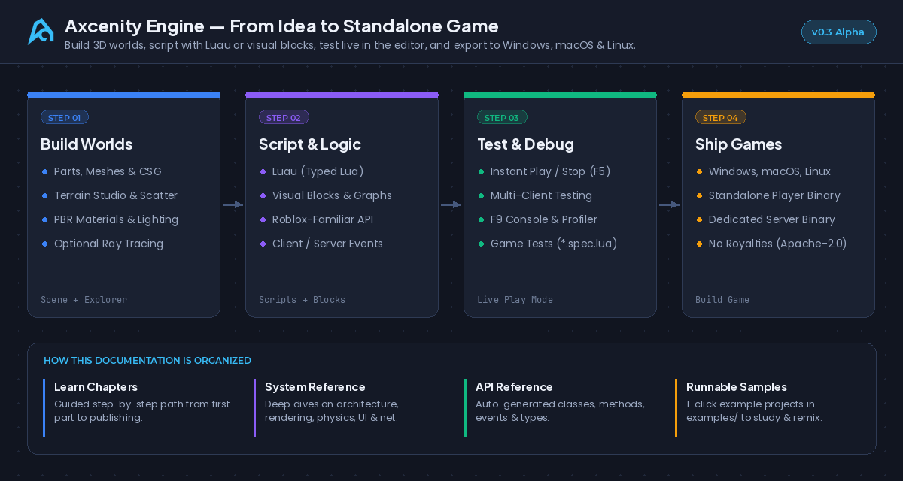

# Axcenity Engine documentation

Welcome to the official documentation for **Axcenity Engine** — a free, open-source 3D game engine and editor written in Rust with Luau scripting and visual blocks. Every page here describes what the engine actually does today, and is automatically verified against the live codebase so links, diagrams, API names, and Lua examples stay accurate.

## Choose your starting point

| Goal | Start here |
|---|---|
| **Brand new to Axcenity?** | Check [System requirements](reference/system-requirements.md), then follow [Getting started](learn/getting-started.md) to build and play your first project in five minutes. |
| **Learning the editor & 3D tools** | Read [Editor interface](learn/editor-interface.md), [Building and moving objects](learn/building.md), and [Explorer and hierarchy](learn/explorer-and-hierarchy.md). |
| **Making worlds look great** | Explore [Materials and textures](learn/materials-and-textures.md), [Lighting and rendering](learn/lighting-and-rendering.md), [Ray tracing](learn/ray-tracing.md), and [Terrain tools](learn/terrain.md). |
| **Writing Luau or visual blocks** | Start with [Scripting and the API](learn/scripting.md) or [Blocks: visual programming](learn/blocks.md), then keep the [Scripting reference](reference/scripting.md) and **API Reference** open beside you. |
| **Adding physics, animation, audio & UI** | Jump to [Physics and collisions](learn/physics.md), [Animation](learn/animation.md), [Audio and spatial sound](learn/audio.md), or [UI for your game](learn/ui.md). |
| **Collaborating & shipping** | See [Collaborate: set up and work together](learn/collaborate.md), [Multiplayer and networking](reference/networking.md), and [Publishing your game](learn/publishing.md). |
| **Understanding the engine & policies** | Read [Engine architecture](reference/architecture.md) and our [AI disclosure and security practices](reference/ai-disclosure.md). |

## How this documentation works

- **Learn chapters** teach each part of Axcenity step by step, paired with runnable sample projects in `crates/samples/projects/` that you can open with one click from the editor's **Learn** tab.
- **Reference pages** go deeper into architecture, file formats, rendering, physics, networking, and debugging when you need exact details while building.
- **API Reference** lists every class, property, method, event, data type, and enum generated directly from the engine's scripting definitions.
- **Offline and online**: these exact pages ship inside the Axcenity Editor (working completely offline under **Learn** and **Documentation**) and are published online at [axcenity.com/docs](https://axcenity.com/docs).

## What the status badges mean

Axcenity is in early alpha (`0.3.0-alpha.1`). Every page states how mature the feature it describes is:

| Badge | Meaning |
|---|---|
| (none) | **Stable**: built, tested, and enabled by default. |
| Partly built | Works today, with a known part missing or off by default. Look for the **Known limits** note on the page. |
| Experimental | Built and usable, but opt-in or still changing between releases. |

Features that do not exist yet are never documented as if they were finished.

## Finding things quickly

- **Search** at the top of the Documentation page searches titles, headings, body text, and image descriptions, and shows matching entries in the API Reference.
- Inline code spans naming an API symbol — such as `Part.Touched`, `Instance:FindFirstChild()`, or `task.wait()` — link straight to their API Reference entry in the editor. Every code block has a **Copy** button.
- Looking for engine internals, architecture decision records (ADRs), or performance history? Visit the [engineering wiki](https://github.com/MrBearson321/Axcenity-Engine/blob/main/wiki/Home.md) in the source repository.
