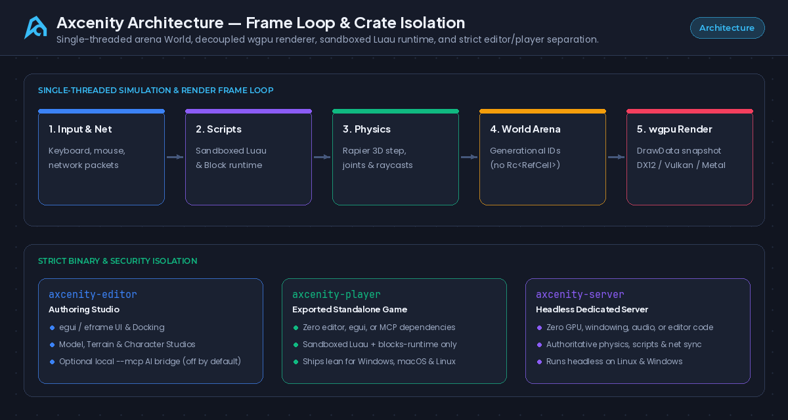

# AI disclosure and security practices

Transparency matters for an open-source game engine. This page explains how AI tools are used while building Axcenity Engine, what stays strictly human-directed, and the concrete engineering and security safeguards in place to prevent vulnerabilities, regressions, and licensing issues.

## How AI is used in this project

Axcenity Engine is created and maintained by Paul Janota with assistance from AI coding tools (such as Claude Code, Codex, and Antigravity) operating under human direction and review.

| Area | Relative scope of AI assistance | Human oversight |
|---|---|---|
| **Engine architecture & ADRs** | Research, trade-off analysis, and drafting documentation | All architectural decisions, crate boundaries, and ADRs are owned and approved by the maintainer |
| **Rust engine & editor code** | Assisting with subsystem implementation, editor UI, refactoring, and bug fixes | Reviewed against project invariants, architecture docs, and local test suites before landing |
| **Automated tests** | Writing unit tests, integration tests, doc checks, and UI snapshot tests | Verified by running the workspace test suite and inspecting visual snapshots |
| **User & developer docs** | Drafting and updating guides, reference pages, and diagrams | Checked against live source code and automated documentation tests |
| **Releases & licensing** | Preparing release notes and packaging scripts | Final builds, release tagging, dependency choices, and license compliance are human-approved |

## Engine development vs. games you build

AI assistance during engine development does **not** put AI models, telemetry, or cloud dependencies into Axcenity or into the games you export:

- **Exported games** (`axcenity-player`) and **dedicated servers** (`axcenity-server`) contain zero AI models, zero AI SDKs, and zero editor code.
- **Optional editor AI bridge** (`--mcp`): the editor includes an opt-in local Model Context Protocol server for developers who choose to connect their own AI assistant while editing a project. It is off by default, never included in exported games or dedicated servers, and every write it performs goes through the editor's undo history with rollback on failure.
- **No hidden network calls or training data collection**: Axcenity does not send your projects, scripts, or assets to any AI provider.

## Security and quality safeguards

Because AI-assisted code can introduce subtle bugs or unsafe patterns if left unchecked, Axcenity enforces multiple layers of compile-time, runtime, and process safeguards:

- **Memory safety enforced at compile time**: the entire Rust workspace sets `unsafe_code = "deny"` in `Cargo.toml`, blocking `unsafe` Rust across engine crates (with a single narrowly scoped exemption in `crates/script/src/debugger.rs`).
- **Sandboxed game scripting**: both Luau scripts and visual blocks execute inside a restricted Luau VM (`crates/script`). Game scripts cannot access arbitrary OS files, spawn host processes, or open raw network sockets.
- **Strict crate and binary isolation**: architectural invariants verified by workspace structure and tests guarantee that `axcenity-player` and `axcenity-server` never depend on `axcenity-editor`, `egui`, or `axcenity-mcp`, and that the renderer (`axcenity-render`) only consumes draw data without touching scripts or instances.
- **Single-threaded arena World**: instances live in a generational-ID arena owned by one thread; background workers never mutate the World directly, preventing data races and dangling-pointer bugs.
- **Automated local verification gates**: changes are checked locally with `cargo clippy --workspace --all-targets -- -D warnings`, workspace unit and integration tests, doc tests, and automated documentation tests that verify every link, image, API symbol, and Lua code example compiles.
- **Dependency and license hygiene**: all third-party crates are version-pinned in the workspace `Cargo.toml` and `Cargo.lock`, checked for Apache-2.0-compatible licensing, and never added silently.
- **Open-source auditability**: the full source code is public under the Apache License 2.0 so anyone can inspect, audit, and build the engine from source.

> **Known limits:** Axcenity is in early alpha (`0.3.0-alpha.1`) and has not yet undergone a formal third-party security audit. Alpha installers are not yet code-signed. Do not run untrusted projects or untrusted editor plugins without reviewing their scripts first.

## Reporting security issues

If you discover a security vulnerability in the engine, networking layer, script sandbox, or editor, please report it privately rather than opening a public issue. See the repository's [SECURITY.md](https://github.com/MrBearson321/Axcenity-Engine/blob/main/SECURITY.md) for reporting instructions.
